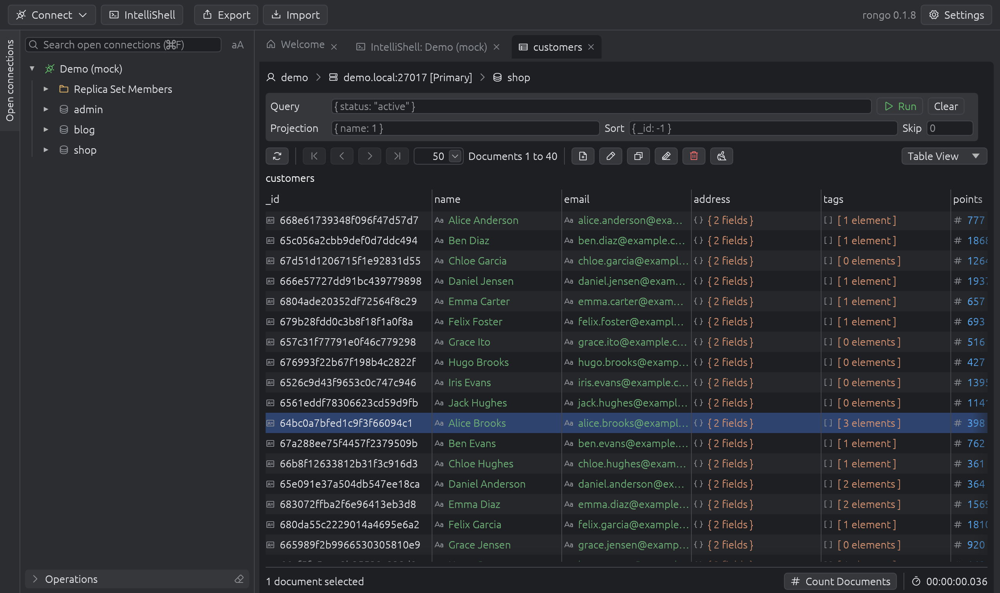
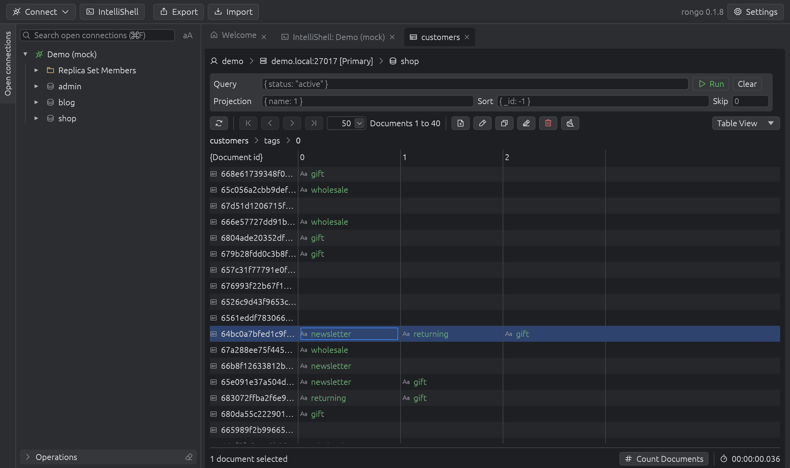
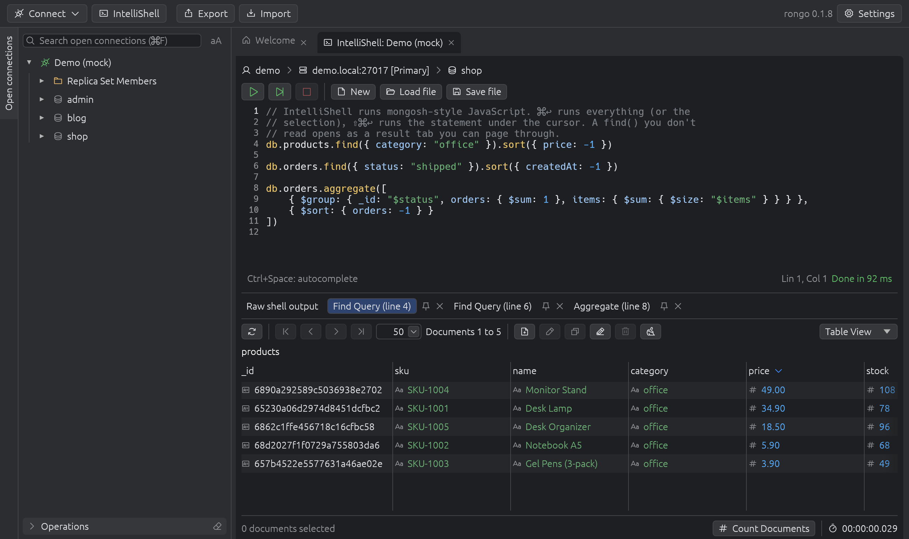

# rongo

A fast desktop MongoDB client for macOS and Windows, written in Rust. If you have used Studio 3T, it will feel familiar: a connection manager, a database tree, collection tabs with Table, Tree and JSON views, a document editor, and an IntelliShell-style JavaScript shell.



- **Table, Tree and JSON views** of any query, up to 50,000 documents a page, smooth to scroll.
- **Drill into objects and arrays** as Studio 3T does: double-click a field to see it for every document.
- **IntelliShell**: run mongosh-style JavaScript with autocomplete, find (⌘F) and word-by-word undo.
- **Edit in place**: edit documents, values and fields, insert and delete, or update and delete many documents with a query.
- **Collection History**: deletes and updates made in rongo's views and dialogs keep the documents as they were, so you can put them back.
- **Safe with production**: give a connection a colour, or lock it read-only so nothing can write to it.
- **Your passwords stay yours**: saved only in an encrypted vault behind a master password.
- Indexes, validation, import and export (JSON, CSV), copying collections between connections, SSH tunnels and TLS.

The full guide to every feature and shortcut is in [GUIDE.md](GUIDE.md). ภาษาไทย: [ติดตั้ง อัปเดต และถอนการติดตั้ง](#ภาษาไทย)

## Install

### macOS (Apple silicon)

With [Homebrew](https://brew.sh):

```sh
brew tap yamete-jpy/rongo https://github.com/yamete-jpy/rongo
brew trust --cask yamete-jpy/rongo/rongo
brew install --cask rongo
```

(Homebrew only installs from someone else's tap after `brew trust`.)

rongo is not notarized by Apple, so macOS blocks its first launch. Either open **System Settings → Privacy & Security**, scroll to *"rongo" was blocked*, and press **Open Anyway**, or run:

```sh
xattr -dr com.apple.quarantine /Applications/rongo.app
```

Without Homebrew: download `rongo-<version>-arm64.dmg` from [Releases](https://github.com/yamete-jpy/rongo/releases), open it, drag rongo onto Applications, then do the step above.

### Windows 10 and 11 (64-bit)

Download `rongo-<version>-x64-setup.exe` from [Releases](https://github.com/yamete-jpy/rongo/releases) and run it. It installs for your account only (no administrator rights) and adds rongo to the Start menu.

The installer is not signed, so SmartScreen says it protected your PC. Press **More info**, then **Run anyway**.

### First launch

rongo asks you to set a **master password**. It locks the vault that keeps your connection passwords; you type it each time rongo starts. There is no way to recover it: if you forget it, Reset deletes the saved passwords (your connections stay, and the Collection History saved so far can no longer be read).

To try rongo without a server, start it with a demo database: `/Applications/rongo.app/Contents/MacOS/rongo --mock` on macOS, `"%LOCALAPPDATA%\Programs\rongo\rongo.exe" --mock` on Windows.

## Update

rongo checks for a new release once a day and shows a banner with the command to run.

**macOS**:

```sh
brew update && brew upgrade --cask rongo
xattr -dr com.apple.quarantine /Applications/rongo.app
```

Run `brew update` first: without it, `brew upgrade` may not see the new release yet. macOS blocks the first launch after every update too, hence the second line (or press **Open Anyway** again).

**Windows**: press **Open Download Page** in the banner (or open [Releases](https://github.com/yamete-jpy/rongo/releases)), download the new installer and run it. It installs over the old version and keeps your connections and settings; close rongo first.

## Uninstall

**macOS**:

```sh
brew uninstall --cask rongo          # keeps your connections, settings and history
brew uninstall --zap --cask rongo    # also deletes them
```

`--zap` deletes `~/Library/Application Support/dev.rongo.rongo` (connections, settings, the password vault and Collection History) and `~/Library/Application Support/rongo` (the window's size and position).

**Windows**: Windows Settings → Apps → rongo → Uninstall. Tick **Remove my data** to also delete your connections, settings, vault and Collection History.

## ภาษาไทย

ติดตั้ง อัปเดต และถอนการติดตั้ง

### ติดตั้งบน Mac (ชิป Apple silicon)

```sh
brew tap yamete-jpy/rongo https://github.com/yamete-jpy/rongo
brew trust --cask yamete-jpy/rongo/rongo
brew install --cask rongo
```

rongo ไม่ได้ผ่านการรับรอง (notarize) จาก Apple ครั้งแรกที่เปิด macOS จะบล็อกไว้ ให้รันคำสั่งนี้ หรือไปที่ **System Settings → Privacy & Security** แล้วกด **Open Anyway**

```sh
xattr -dr com.apple.quarantine /Applications/rongo.app
```

ถ้าไม่ใช้ Homebrew ให้โหลดไฟล์ `.dmg` จากหน้า [Releases](https://github.com/yamete-jpy/rongo/releases) เปิดแล้วลาก rongo ไปใส่ Applications จากนั้นทำขั้นตอนข้างบน

### ติดตั้งบน Windows 10 / 11 (64-bit)

โหลด `rongo-<version>-x64-setup.exe` จากหน้า [Releases](https://github.com/yamete-jpy/rongo/releases) แล้วเปิด ไม่ต้องใช้สิทธิ์ admin ถ้า Windows ขึ้นว่า "Windows protected your PC" ให้กด **More info** แล้ว **Run anyway**

### เปิดครั้งแรก

rongo จะให้ตั้ง **master password** ไว้ล็อกที่เก็บรหัสผ่านของ connection ต้องพิมพ์ทุกครั้งที่เปิด rongo ถ้าลืมจะกู้ไม่ได้ ต้อง Reset ซึ่งจะลบรหัสผ่านที่บันทึกไว้ (ตัว connection ยังอยู่ แต่ Collection History ที่บันทึกไว้แล้วจะอ่านไม่ได้อีก)

### อัปเดต

rongo เช็คเวอร์ชันใหม่วันละครั้ง ถ้ามีจะขึ้นแถบแจ้งพร้อมคำสั่ง (มีปุ่ม Copy)

Mac:

```sh
brew update && brew upgrade --cask rongo
xattr -dr com.apple.quarantine /Applications/rongo.app
```

ต้อง `brew update` ก่อน ไม่งั้น brew อาจยังไม่เห็นเวอร์ชันใหม่ และหลังอัปเดตทุกครั้ง macOS จะบล็อกการเปิดอีก เลยต้องรันบรรทัดที่สอง (หรือกด Open Anyway)

Windows: กด **Open Download Page** ในแถบแจ้ง โหลดตัวติดตั้งใหม่แล้วเปิดทับของเดิมได้เลย connection และการตั้งค่ายังอยู่ ปิด rongo ก่อนติดตั้ง

### ถอนการติดตั้ง

Mac:

```sh
brew uninstall --cask rongo          # เก็บ connection การตั้งค่า และประวัติไว้
brew uninstall --zap --cask rongo    # ลบทั้งหมดด้วย
```

Windows: Settings → Apps → rongo → Uninstall ติ๊ก **Remove my data** ถ้าต้องการลบ connection การตั้งค่า และประวัติด้วย

## Screenshots

Drilling into an array: every document's `tags`, one column per element, as Studio 3T shows it.



IntelliShell: a script and its results.



## Build from source

```sh
cargo run --release -p rongo -- --mock   # with the demo database, no MongoDB needed
```

See [GUIDE.md](GUIDE.md#build-from-source) for the app bundle, the disk image and the Windows installer.

## License

MIT
